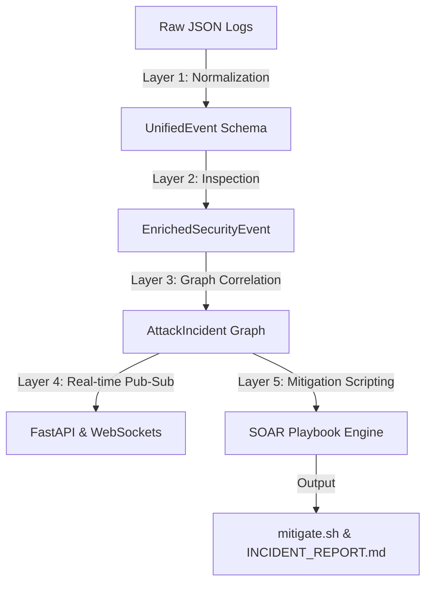

# ATTACKTRACE — High-Fidelity Threat Correlation & SOAR Orchestration

This document details the architectural blueprints, sliding-window algorithms, risk-scoring mechanics, and extensibility design of the ATTACKTRACE cybersecurity platform.

---

## 1. Architectural Blueprint & Data Flow

ATTACKTRACE implements a structured, non-blocking 5-layer pipeline that transforms raw unstructured logging telemetry into correlated threat incidents, live visualization elements, and executable SOAR playbooks.



### 1.1. Processing Layer Functions

1. **Layer 1 (Ingestion)**: Performs schema validation and strict structure enforcement. Malformed log entries (missing `timestamp`, `source_type`, or `event_type`) are dropped safely into a structured error list, preventing pipeline crashes.
2. **Layer 2 (Enrichment)**: Runs signatures against HTTP paths, request parameters, and database queries. Extracts MITRE ATT&CK TTPs and scores the risk impact.
3. **Layer 3 (Correlation)**: Groups enriched events by actor (IP address) and targets (usernames). Orders events chronologically, tracking transition bounds.
4. **Layer 4 (Delivery)**: Exposes endpoints for streaming events and querying incident topologies. Streams live events dynamically over WebSocket channels using non-blocking connection hubs.
5. **Layer 5 (Orchestration)**: Integrates Threat Intelligence and generates SOAR playbook scripts.

---

## 2. Sliding-Window Correlation Algorithm

Isolation of network alerts leads to alert fatigue. ATTACKTRACE reconstructs full attack stories by correlating disparate events over time.

### 2.1. Algorithm Mechanics
* **Group by Primary Actor**: Telemetry is grouped by the initiating node (`source_ip`).
* **Sliding Temporal Window**: Events are added to a chronological list. If the interval between the current event and the first event of the incident window exceeds $T_{\text{window}}$ (default: 60 minutes), the sliding window splits the logs into separate threat campaigns.
* **Incident Promotion Filter**: Log clusters are promoted to full `AttackIncident` entities if they satisfy either condition:
  $$\text{distinct\_kill\_chain\_stages} \ge 2 \quad \text{OR} \quad \text{max\_event\_risk\_score} \ge 70$$

### 2.2. Confidence Scoring Formula
The system rates incident confidence ($C$) dynamically based on both traversal breadth and severity severity:
$$C = \min\left(30 + (\text{num\_stages} \times 12) + (\text{max\_risk} \times 0.25), 100\right)$$

* **`num_stages`**: Number of unique `KillChainStage` milestones traversed.
* **`max_risk`**: Highest individual risk score computed among all correlated steps.

---

## 3. Threat Classification & Risk Scoring Model

Enrichment scores events on a scale from `0` to `100` based on signature weights:

| Signature ID | Associated MITRE Technique | Description | Weight |
|---|---|---|---|
| `SUSPICIOUS_WEB_RECON` | `T1595 - Active Scanning` | Scans for sensitive environment config backups (`.env`). | 25 |
| `FAILED_AUTH_BURST` | `T1110 - Brute Force` | High-frequency password guessing on portals. | 55 |
| `SQL_INJECTION_PATTERN` | `T1190 - Exploit Public-Facing App` | SQL syntax parameters (e.g. `UNION SELECT`). | 65 |
| `PRIVILEGE_ESCALATION` | `T1078 - Valid Accounts` | Modifying permission descriptors (e.g., `/etc/sudoers`). | 85 |
| `UNAUTHORIZED_EXFILTRATION` | `T1005 - Data from Local System` | Downloading query outputs or exporting backups. | 80 |

### 3.1. Severity Mapping Table
The total risk score mapping:
* **`CRITICAL`**: $90 \le R \le 100$
* **`HIGH`**: $70 \le R < 90$
* **`MEDIUM`**: $40 \le R < 70$
* **`LOW`**: $20 \le R < 40$
* **`INFO`**: $0 \le R < 20$

---

## 4. Extensibility Guide

To scale detection rules or support new log sources, follow these extension paths:

### 4.1. Adding a Custom Log Source
1. Define the parsing mapping inside `src/collector.py`.
2. Map the logs structure (e.g. cloudtrail, syslog) to populate `UnifiedEvent` (ensuring correct parsing of `source_type` and `event_type`).

### 4.2. Adding a Detection Signature
Extend `src/mitre_mapper.py` by registering a custom signature rule:
```python
# In src/mitre_mapper.py:
def match_custom_threat(self, event: UnifiedEvent) -> bool:
    # Example: Look for unauthorized docker daemon calls
    return "/var/run/docker.sock" in (event.resource or "")

# Register under map_event():
if self.match_custom_threat(event):
    indicators.append("DOCKER_SOCKET_ACCESS")
    tactics.append("Execution")
    techniques.append({"id": "T1609", "name": "Container Administration Command"})
```
Register the indicator's default weight inside `src/parser.py`:
```python
# In src/parser.py:
INDICATOR_WEIGHTS = {
    "DOCKER_SOCKET_ACCESS": 90, # Highly suspicious execution
    # ...
}
```
The pipeline will automatically propagate the signature into risk scoring, graph reconstruction, real-time WebSocket alerts, and SOAR mitigation script compiling.
