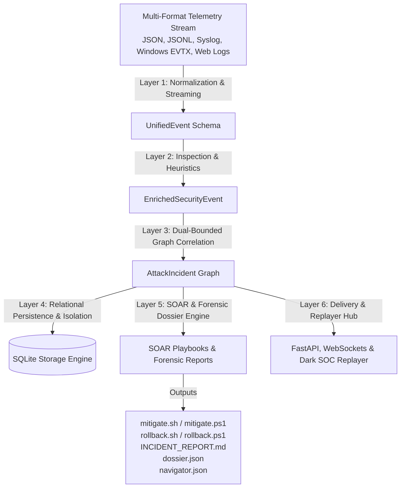

# ATTACKTRACE — High-Fidelity Threat Correlation & SOAR Orchestration

This document details the complete 6-layer architecture, data models, persistence schemas, correlation mechanics, forensic engines, and extensibility design of **ATTACKTRACE v1.0.0**.

---

## 1. Architectural Blueprint & Data Flow

ATTACKTRACE implements a structured, modular 6-layer pipeline that transforms raw unstructured logging telemetry into correlated threat incidents, live visualization elements, triple-format forensic dossiers, and atomic SOAR remediation playbooks.



### 1.1. Processing Layer Responsibilities

1. **Layer 1 (Multi-Format Telemetry Ingestion)**:
   - Memory-efficient streaming generator for Newline-Delimited JSON (`.jsonl`) avoiding Out-Of-Memory (OOM) on large log files.
   - Normalizes Windows Security Event Logs (`WindowsEventAdapter` for Event IDs 4624, 4625, 4688, 4672).
   - Normalizes RFC 3164 and RFC 5424 Syslog (`SyslogAdapter` for SSH failed/accepted logins and sudo commands).
   - Normalizes Apache / Nginx Web Server Access Logs (`WebLogAdapter` for Combined/Common log format with URL query decoding).
   - Validates canonical `UnifiedEvent` schema and quarantines malformed records into `dropped_events` with line numbers and reasons.

2. **Layer 2 (Heuristic Parser & MITRE ATT&CK Enrichment)**:
   - Evaluates telemetry against calibrated MITRE ATT&CK Enterprise signatures.
   - Computes weighted risk scores ($0 \le R \le 100$) and maps them to severity tiers (`INFO`, `LOW`, `MEDIUM`, `HIGH`, `CRITICAL`).

3. **Layer 3 (Dual-Bounded Sliding Window Correlation)**:
   - Groups events by primary initiating actor (`source_ip`) and targeted users.
   - Applies dual-bounding temporal thresholds to split long campaigns and detect lateral movement.
   - Calculates dynamic incident confidence scores ($C$) and constructs directed causal attack graph topologies.

4. **Layer 4 (SQLite Persistence & Clean Demo Isolation)**:
   - Persists normalized events, enriched events, incidents, steps, and SOAR mitigation actions into an ACID relational database (`~/.attacktrace/attacktrace.db` or custom file).
   - Enforces strict isolation with `is_demo=1` (purgeable synthetic demo state) versus `is_demo=0` (permanent production audit history).

5. **Layer 5 (SOAR Playbook & Forensic Dossier Engine)**:
   - Resolves IP attribution using offline Threat Intelligence.
   - Generates cross-platform containment playbooks (`mitigate.sh` or `mitigate.ps1`).
   - Generates reverse atomic rollback scripts (`rollback.sh` or `rollback.ps1`) backed by cryptographic SHA-256 tokens.
   - Compiles triple forensic formats: Executive Markdown report, machine-readable JSON dossier, and official MITRE ATT&CK Navigator v4.5 layer.

6. **Layer 6 (WebSockets & Dark SOC Web Console)**:
   - Real-time pub/sub alert broadcasting via FastAPI WebSocket hub.
   - High-density dark SOC console (`#070a13` background, Slate `#0f1422` cards, Cyan `#00d2ff` accents).
   - **Time-Travel Attack Replayer**: Interactive timeline scrubber dynamically filtering D3 nodes/edges with an animated radar pulse (`@keyframes radar-ripple`) highlighting active adversary steps.
   - Multi-platform scenario switcher modal and 1-click forensic download center.

---

## 2. Dual-Bounding Temporal Correlation Algorithm

Traditional SIEMs produce excessive alert fatigue by alerting on isolated events. ATTACKTRACE reconstructs full adversary narratives across time.

```text
                [ Window Start: T_start ]
                      │
  Event 1 ───► Event 2 ───► Event 3 ───────────────► Event N
     │                                                   │
     └───────────── Δt_sliding <= T_window ─────────────┘
     │                                                   │
     └────────────── Max Duration <= T_max ──────────────┘
```

### 2.1. Dual-Bounding Mechanics
* **Group by Primary Actor**: Telemetry is partitioned by `source_ip`.
* **Sliding Step Threshold ($T_{\text{window}}$)**: Events are evaluated sequentially. If the gap between step $k$ and step $k+1$ exceeds $T_{\text{window}}$ (default: 60 minutes), the chain is segmented into separate campaigns.
* **Maximum Duration Ceiling ($T_{\text{max}}$)**: Even if events occur continuously within $T_{\text{window}}$, an incident is bounded if total elapsed time ($t_N - t_1$) reaches $T_{\text{max}}$ (default: 240 minutes), preventing month-long APT campaigns from collapsing into a single unwieldy incident.
* **Incident Promotion Filter**: Event clusters are promoted to full `AttackIncident` entities if they meet either condition:
  $$\text{distinct\_kill\_chain\_stages} \ge 2 \quad \text{OR} \quad \text{max\_event\_risk\_score} \ge 70$$

### 2.2. Confidence Scoring Formula
Incident confidence ($C$) is calculated dynamically based on kill-chain stage breadth and maximum observed severity:
$$C = \min\left(30 + (\text{num\_stages} \times 12) + (\text{max\_risk} \times 0.25), 100\right)$$

* **`num_stages`**: Count of distinct `KillChainStage` milestones achieved.
* **`max_risk`**: Highest individual risk score computed among all correlated steps.

---

## 3. Database Schema & Demo Isolation Architecture

ATTACKTRACE utilizes a normalized SQLite schema with foreign key cascading and strict partition flags.

```sql
-- Core Events Table
CREATE TABLE IF NOT EXISTS events (
    event_id TEXT PRIMARY KEY,
    timestamp TEXT NOT NULL,
    source_type TEXT NOT NULL,
    event_type TEXT NOT NULL,
    user TEXT,
    source_ip TEXT,
    resource TEXT,
    status INTEGER,
    raw_payload TEXT,
    is_demo INTEGER DEFAULT 0,
    created_at TIMESTAMP DEFAULT CURRENT_TIMESTAMP
);

-- Enriched Events Table
CREATE TABLE IF NOT EXISTS enriched_events (
    event_id TEXT PRIMARY KEY,
    severity TEXT NOT NULL,
    mitre_tactics TEXT,
    mitre_techniques TEXT,
    indicators TEXT,
    risk_score INTEGER NOT NULL,
    is_demo INTEGER DEFAULT 0,
    FOREIGN KEY(event_id) REFERENCES events(event_id) ON DELETE CASCADE
);

-- Correlated Incidents Table
CREATE TABLE IF NOT EXISTS incidents (
    incident_id TEXT PRIMARY KEY,
    primary_actor_ip TEXT,
    targeted_users TEXT,
    start_time TEXT,
    end_time TEXT,
    overall_severity TEXT,
    confidence_score INTEGER,
    stages_detected TEXT,
    is_demo INTEGER DEFAULT 0,
    created_at TIMESTAMP DEFAULT CURRENT_TIMESTAMP
);

-- Attack Steps Table (Incident Topology)
CREATE TABLE IF NOT EXISTS attack_steps (
    step_id TEXT PRIMARY KEY,
    incident_id TEXT NOT NULL,
    stage TEXT NOT NULL,
    timestamp TEXT NOT NULL,
    technique TEXT NOT NULL,
    description TEXT,
    actor TEXT,
    risk_score INTEGER,
    is_demo INTEGER DEFAULT 0,
    FOREIGN KEY(incident_id) REFERENCES incidents(incident_id) ON DELETE CASCADE
);

-- SOAR Actions Table
CREATE TABLE IF NOT EXISTS soar_actions (
    action_id TEXT PRIMARY KEY,
    incident_id TEXT NOT NULL,
    action_type TEXT NOT NULL,
    target TEXT NOT NULL,
    command TEXT NOT NULL,
    rollback_token TEXT NOT NULL,
    rollback_command TEXT NOT NULL,
    status TEXT NOT NULL,
    is_demo INTEGER DEFAULT 0,
    created_at TIMESTAMP DEFAULT CURRENT_TIMESTAMP,
    FOREIGN KEY(incident_id) REFERENCES incidents(incident_id) ON DELETE CASCADE
);
```

### 3.1. Zero-Contamination Isolation
* Real telemetry (`attacktrace ingest <file>`) is stamped with `is_demo = 0` and preserves file provenance in `raw_payload["_provenance_file"]`.
* Synthetic breach simulations (`attacktrace demo`) are stamped with `is_demo = 1`.
* Purging demo data (`POST /api/v1/demo/reset` or `attacktrace demo --reset`) executes an isolated cascade delete targeting solely `is_demo = 1` rows, completely protecting real security audits from data loss.

---

## 4. Multi-Format Telemetry Adapters

| Adapter | Telemetry Ingestion Source | Extracted Attributes | Mapped Event Types |
|---|---|---|---|
| **`WindowsEventAdapter`** | Windows Security EVTX / JSON (Event IDs 4624, 4625, 4688, 4672) | `TargetUserName`, `SubjectUserName`, `IpAddress`, `LogonType`, `NewProcessName`, `CommandLine`, `PrivilegeList` | `LOGIN_SUCCESS`, `LOGIN_FAILED`, `PROCESS_CREATION`, `PRIVILEGE_ASSIGNED` |
| **`SyslogAdapter`** | Linux RFC 3164 (BSD) & RFC 5424 Syslog strings | `<PRI>`, timestamp, `hostname`, `app`, `user`, `ip`, `command` | `LOGIN_FAILED` (SSH), `LOGIN_SUCCESS` (SSH), `PRIVILEGE_ASSIGNED` (sudo), `SYSTEM_LOG` |
| **`WebLogAdapter`** | Apache / Nginx Combined & Common Log Format | `source_ip`, timestamp, `http_method`, URL path & decoded query string, `status_code`, `user_agent` | `API_REQUEST` (`source_type="web"`) |
| **Streaming JSONL** | Line-delimited JSON (`.jsonl`) | Canonical `UnifiedEvent` or nested Windows events | Any canonical event type |

---

## 5. Extensibility Guide

### 5.1. Adding a New Signature
1. Register signature pattern matching in `src/mitre_mapper.py`:
   ```python
   # Example: Container Escape Detection
   if "nsenter" in (event.resource or "").lower():
       tactics.add("Privilege Escalation")
       techniques.append({"id": "T1611", "name": "Escape to Host"})
       indicators.add("CONTAINER_ESCAPE_ATTEMPT")
   ```
2. Assign weight in `src/parser.py`:
   ```python
   INDICATOR_WEIGHTS["CONTAINER_ESCAPE_ATTEMPT"] = 95
   ```
3. The pipeline automatically factors the new signature into risk scoring, confidence formulas, D3 topologies, SOAR actions, and MITRE Navigator layers.
